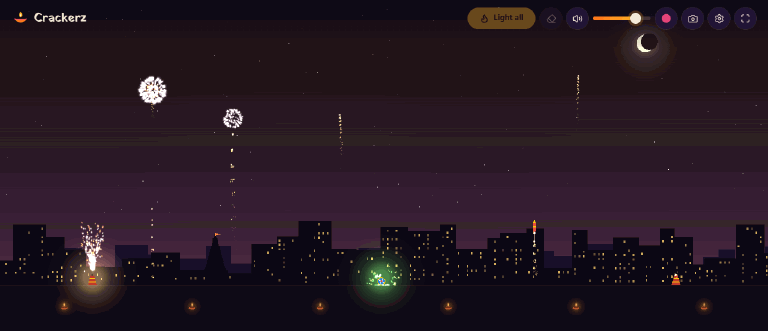
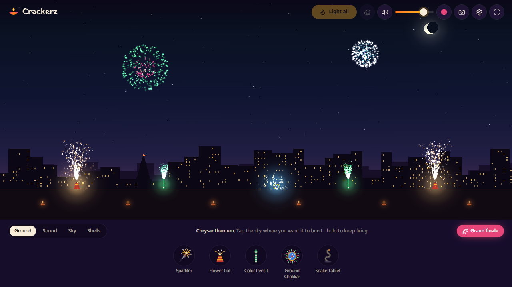
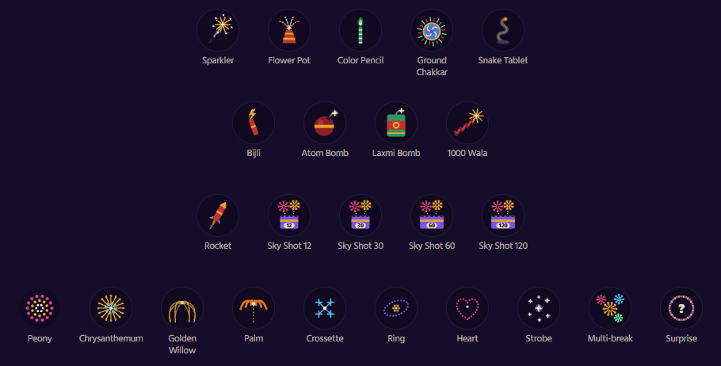
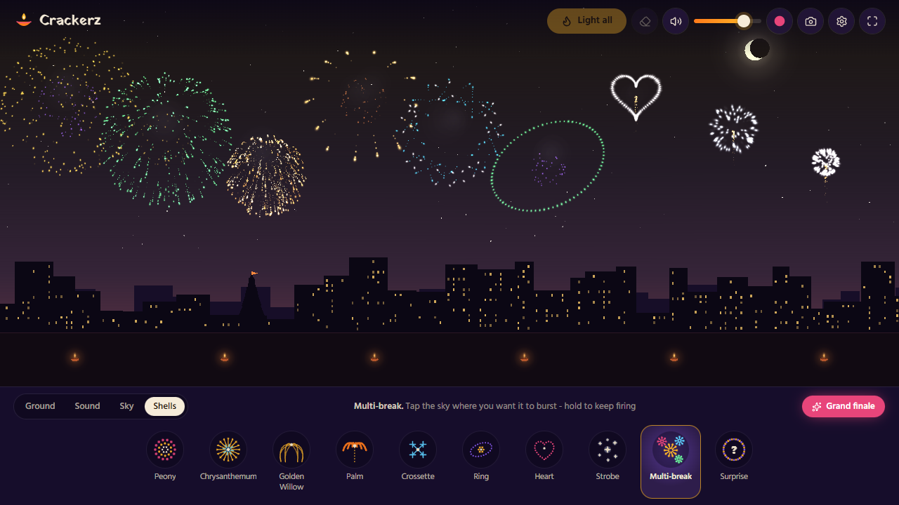
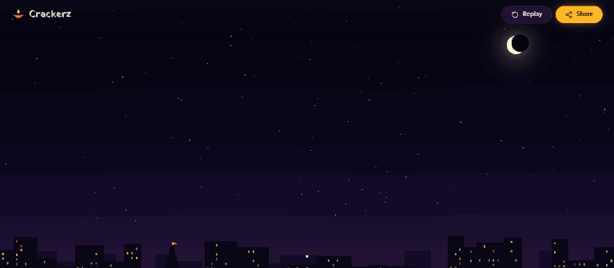
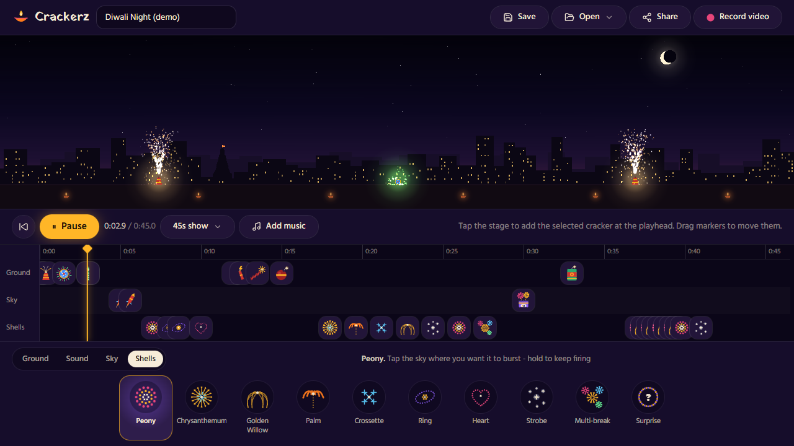
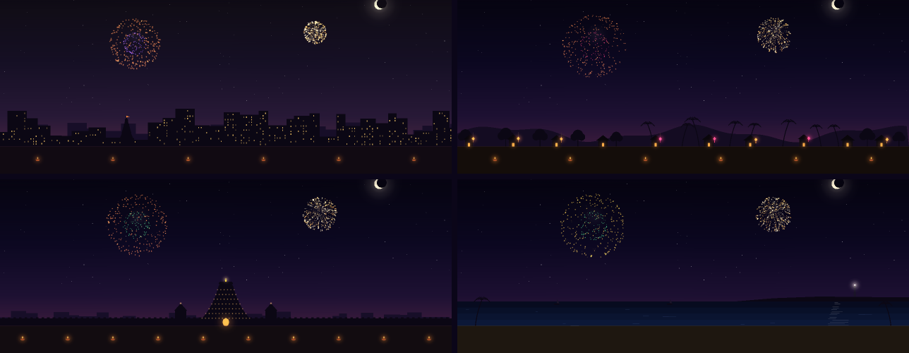
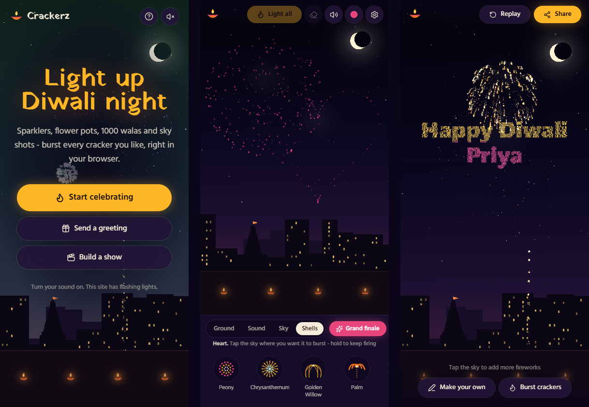

<div align="center">

# 🪔 Crackerz

**Burst Diwali crackers right in your browser.**<br>
Sparklers, flower pots, 1000 walas, rockets, sky shots and nine kinds of sky shells. No smoke, no burns, and no noise for the neighbours.

[**▶ Play now**](https://karthikjl.github.io/crackerz/) · [Send a greeting](https://karthikjl.github.io/crackerz/greeting/) · [Build a show](https://karthikjl.github.io/crackerz/show/)

[](https://github.com/Karthikjl/crackerz/actions/workflows/deploy.yml)


[](LICENSE)



</div>

---

## What you can do

### Burst any cracker you like

Pick a cracker, tap the ground to place it and tap it again to light it. Or press **Light all** and watch them go off one by one. Sky shells burst wherever you tap in the sky. Hold your finger down to keep firing.





### Nine kinds of sky shells

Peony, chrysanthemum, golden willow, palm, crossette, ring, heart, strobe and multi-break. **Surprise** picks one at random, and **Grand finale** fires a barrage that builds up to one huge volley.



### Send a fireworks greeting

Type someone's name and a message. They get a link where "Happy Diwali" and their name burst across the night sky. Share it on WhatsApp or anywhere else. There's no sign-up, because the whole greeting lives in the link.



### Build your own show

Tap the stage to add crackers at the playhead, then drag them along the timeline. Add your own song, save shows on your device, share a show as a link, or record it as a video with sound. A 45-second demo show is ready to play.



### Four places to celebrate

City, village, temple or beach. Each one has its own skyline, lights and diyas.



### Made for phones too

Multi-touch, haptic thumps on the big bangs, and an installable app that works offline.



---

## The crackers

| Group | Crackers |
|---|---|
| **Ground** | Sparkler (press and drag to draw with light) · Flower pot · Color pencil · Ground chakkar · Snake tablet |
| **Sound** | Bijli · Atom bomb · Laxmi bomb (with a shockwave) · 1000 wala chain |
| **Sky** | Rocket · Sky shot 12 / 30 / 60 / 120 |
| **Shells** | Peony · Chrysanthemum · Golden willow · Palm · Crossette · Ring · Heart · Strobe · Multi-break · Surprise |

Every sound is generated live in the browser with the Web Audio API, so the site ships no audio files.

---

## Celebrate safely 🧯

Crackerz is a safe way to enjoy the show. When you celebrate with real crackers:

- Light them outdoors at arm's length, and never hold one in your hand.
- Children should always have an adult with them.
- Keep a bucket of water or sand nearby, and never relight a cracker that didn't go off.
- Choose green crackers, follow local time limits, and burst fewer to keep the air clean.
- Loud bangs frighten pets, birds and older people, so keep the noise down near them.

> ⚠️ This site has flashing lights. Turn on **Reduce flashing** in Settings to soften sky flashes and stop strobes and screen shake. It switches on by itself if your device asks for reduced motion.

---

## Built with

| | |
|---|---|
| **App** | [Next.js 15](https://nextjs.org) (App Router, static export) · React 19 · TypeScript (strict) |
| **Fireworks** | [PixiJS v8](https://pixijs.com) WebGL with a custom particle engine (struct-of-arrays pool, no per-frame allocation) |
| **Sound** | Procedural Web Audio: booms, bangs, crackle, whistles and fuse hiss, all synthesised |
| **State** | [Zustand](https://zustand.docs.pmnd.rs), with settings and saved shows kept in `localStorage` |
| **UI** | Tailwind CSS v4 · [Lucide](https://lucide.dev) icons · hand-drawn SVG cracker icons · Yatra One and Hind fonts |
| **Tests** | [Vitest](https://vitest.dev) for the particle physics, burst patterns, show links and adaptive quality |

There's no backend. Everything runs in the browser, and greetings and shows are shared by encoding them in the URL.

**Smooth on slow devices too.** An adaptive quality controller watches the real frame rate and lowers render resolution, particle count and smoke when a device struggles, then raises them again when there's headroom. Add `?debug` to the playground URL to see live FPS.

---

## Run it locally

You need [Node.js](https://nodejs.org) 20 or newer.

```bash
git clone https://github.com/Karthikjl/crackerz.git
cd crackerz
npm install
npm run dev          # http://localhost:3000
```

| Command | What it does |
|---|---|
| `npm run dev` | Development server with hot reload |
| `npm run build` | Static site in `out/` |
| `npm start` | Serves the built `out/` folder on port 3000 (offline mode works here) |
| `npm test` | Unit tests |
| `npm run lint` · `npm run typecheck` | ESLint · TypeScript |

## Deploy

Every push to `main` runs `.github/workflows/deploy.yml`, which installs, runs the tests, builds and publishes to GitHub Pages. The workflow reads the repo name and serves the site from that sub-folder (`/crackerz/`), so share links, offline mode and the installable app all work there.

To deploy your own copy, fork the repo, set **Settings → Pages → Source** to **GitHub Actions**, and push.

<details>
<summary><b>Project layout</b></summary>

```
src/
├─ app/            Pages: home, /play, /greeting, /show, plus the PWA manifest
├─ engine/         Fireworks engine: particles, crackers, bursts, scenes, smoke, adaptive quality
├─ crackers/       The cracker catalog (pure data: colors, speeds, timings)
├─ audio/          Procedural sound engine
├─ show/           Show format, share-link codec, demo show, saved shows
├─ components/     UI: tray, settings, greeting, show builder, timeline, icons
└─ store/          App state and saved settings
public/            Service worker and app icons
docs/images/       Screenshots and GIFs for this README
```

</details>

---

## License

[MIT](LICENSE) © 2026 Karthikjl. You're free to use, change and share Crackerz, as long as you keep the copyright notice.

---

<div align="center">

Made for Diwali with 🪔 and a lot of virtual gunpowder.<br>
**[Light up the sky](https://karthikjl.github.io/crackerz/)**

</div>
